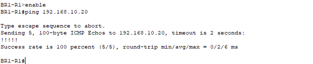
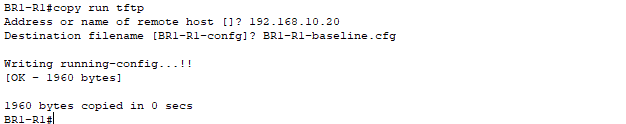
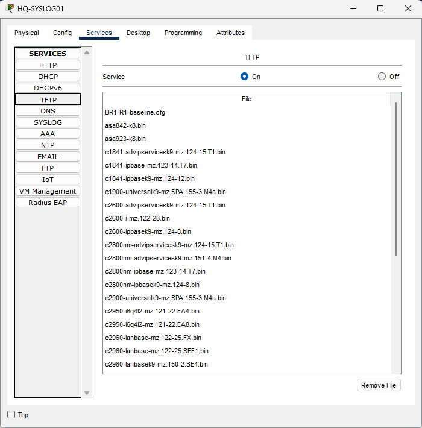
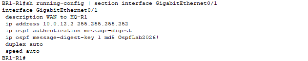
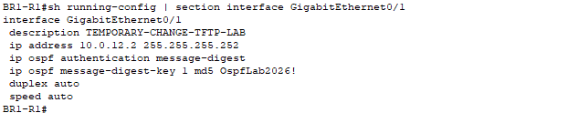
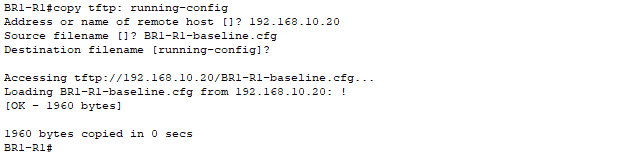
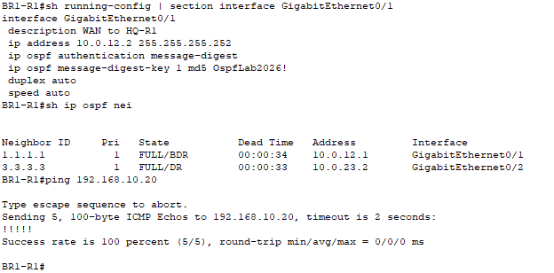

# Multisite Router Configuration Backup and Recovery

Backed up BR1-R1's running configuration to a TFTP server, changed an interface description, and restored the original description by loading the backup into the running configuration. Verification confirmed both OSPF neighbors were FULL and the server remained reachable after the restore.

## Environment

Cisco Packet Tracer multisite lab with HQ-R1, BR1-R1, and BR2-R1. This project continues from the completed OSPF authentication lab.

| Device or file | Role / value |
| --- | --- |
| BR1-R1 | Router being backed up and restored |
| HQ-SYSLOG01 | Existing server with TFTP service enabled |
| TFTP server address | 192.168.10.20 |
| BR1 G0/1 | 10.0.12.2/30, WAN connection toward HQ |
| HQ neighbor router ID | 1.1.1.1 |
| BR2 neighbor router ID | 3.3.3.3 |
| Backup filename | BR1-R1-baseline.cfg |
| Backup transfer size | 1,960 bytes |

The existing routing, OSPF authentication, and management configuration were inherited from earlier labs. Only BR1 G0/1's description was deliberately changed in this exercise.

## Objectives

- Verify connectivity to a backup server.
- Export a router's running configuration using TFTP.
- Confirm the backup file is present on the server.
- Make a controlled configuration change.
- Retrieve and apply the backup, then verify the restored setting and network operation.
- Understand the difference between a configuration merge and a complete replacement.

## 1. Enable TFTP and verify reachability

On HQ-SYSLOG01, **Services → TFTP → On** enabled the service.

On BR1-R1:

```text
enable
ping 192.168.10.20
```

All five ping requests succeeded. This established IP reachability; the subsequent file transfer verified TFTP operation.



## 2. Back up the running configuration

On BR1-R1:

```text
copy running-config tftp:
```

Prompt responses:

```text
Address or name of remote host []? 192.168.10.20
Destination filename [BR1-R1-confg]? BR1-R1-baseline.cfg
```

The router reported `[OK - 1960 bytes]` and `1960 bytes copied`.



The server's **Services → TFTP** file list showed `BR1-R1-baseline.cfg`. The baseline backup was retained while the controlled change was made.



## 3. Record the original setting

```text
show running-config | section interface GigabitEthernet0/1
```

The original interface description was:

```text
interface GigabitEthernet0/1
 description WAN to HQ-R1
```

The output also showed the existing IP address and OSPF message-digest configuration.



## 4. Make a controlled change

```text
configure terminal
interface gigabitEthernet0/1
description TEMPORARY-CHANGE-TFTP-LAB
end
show running-config | section interface GigabitEthernet0/1
```

Verification showed the temporary description. This was a metadata change, rather than a deliberately introduced routing outage.



## 5. Retrieve and apply the backup

```text
copy tftp: running-config
```

Prompt responses:

```text
Address or name of remote host []? 192.168.10.20
Source filename []? BR1-R1-baseline.cfg
Destination filename [running-config]?
```

Enter accepted the destination. The router loaded the file and reported a successful 1,960-byte transfer.



### Why the original description returned

The backup contained `description WAN to HQ-R1` under G0/1. Loading it into the running configuration applied that command again, replacing the temporary description because an interface has a single description value.

**Copying a file into running-config merges its commands with the active configuration. It is not a complete configuration replacement.** Commands absent from the backup are not automatically removed. This exercise demonstrates restoration of the changed description, not proof that every setting became identical to the backup.

## 6. Verify and save

```text
show running-config | section interface GigabitEthernet0/1
show ip ospf neighbor
ping 192.168.10.20
```

| Check | Observed result |
| --- | --- |
| G0/1 description | Restored to WAN to HQ-R1 |
| G0/1 address | 10.0.12.2/30 |
| OSPF authentication configuration | Message-digest and key ID 1 present |
| HQ neighbor 1.1.1.1 | FULL/BDR on G0/1 |
| BR2 neighbor 3.3.3.3 | FULL/DR on G0/2 |
| Ping to 192.168.10.20 | 100% success, 5/5 |



The verified configuration was saved on BR1-R1:

```text
copy running-config startup-config
```

The Packet Tracer project was also saved as `multisite-tftp-backup-recovery.pkt`.

## Lessons and limits

- Back up a known working configuration before making changes, and preserve that baseline during testing.
- A successful transfer should be followed by configuration and operational verification.
- Running-config is the active configuration; startup-config is the saved configuration used at boot. This lab exported running-config and saved the verified result to startup-config.
- TFTP provides no built-in login authentication or encryption. Router backups can contain credentials and network details. This isolated learning lab uses disposable lab values; production backups require protected storage and an appropriately secured transfer method.
- No reboot, factory reset, replacement-router recovery, full configuration comparison, or checksum verification was performed.
- The post-restore checks show operation at the time of verification; uninterrupted traffic or session continuity was not measured.

## Project file

[Download the Packet Tracer lab](multisite-tftp-backup-recovery.pkt)
